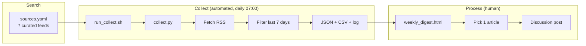

# Collect workflow — technical architecture

This is the **Collect** stage of the class *Search, Collect, Process* loop. The system watches seven curated technology sources, pulls their RSS/Atom feeds every day, keeps only items from the last seven days, and writes a ranked digest I use to choose the weekly discussion-post article.

## Why this architecture

A ChatGPT subscription plus manual browsing would work, but it fails the “last 7 days” requirement whenever I forget to look. An RSS collector is a better Collect layer because:

- Every chosen source publishes a public feed, so collection does not depend on scraping.
- Dates come from the feed, so the 7-day window is mechanical rather than remembered.
- Failures are visible. If IEEE Spectrum or a company blog goes down, the source-health table says so.
- The same run produces JSON, CSV, Markdown, and HTML, so I can review in a browser or pick an article from a spreadsheet.

Search stays human (`sources.yaml`). Collect is automated (`collect.py` + launchd). Process stays human (read the digest, choose one article, write the post).

## Components

| Piece | Role |
|---|---|
| `sources.yaml` | Curated catalog: name, RSS URL, category, and why the source is in the set |
| `collect.py` | Fetch → parse → 7-day filter → keyword score → dedupe → store → digest |
| `.venv` | Isolated Python 3.14 environment (`feedparser`, `requests`, `PyYAML`) |
| `run_collect.sh` | Creates the venv if needed and runs the collector |
| `schedule/com.sanjay.techcollect.plist` | macOS launchd job, daily at 07:00 |
| `data/articles.json` | Canonical store of in-window articles |
| `data/articles.csv` | Spreadsheet view for sorting/filtering |
| `data/weekly_digest.html` | Browser briefing used on review days |
| `data/collect.log` | Run history and per-source success/fail |

## Data flow

```text
sources.yaml
     │
     ▼
collect.py  ──HTTP GET + custom User-Agent──►  RSS/Atom feeds (7 sources)
     │
     ├─ parse title, URL, published date, summary
     ├─ drop items older than 7 days
     ├─ score titles/summaries against AI/tech keywords
     ├─ dedupe by SHA-256 of the article URL
     │
     ├─► data/articles.json
     ├─► data/articles.csv
     ├─► data/weekly_digest.md
     ├─► data/weekly_digest.html   ──► Sunday article pick ──► discussion post
     └─► data/collect.log
```



## Review frequency

| Cadence | What happens | Who |
|---|---|---|
| Daily, 7:00 AM | RSS collect, 7-day filter, digest refresh | Automated (`launchd`) |
| Wednesday evening, ~15 minutes | Skim the digest, star 2–3 candidates | Me |
| Sunday morning, ~45–60 minutes | Confirm the article is ≤7 days old, read it, write the discussion post | Me |
| First Sunday of each month, ~20 minutes | Source-list review: drop dead feeds, add a new company blog or aggregator if the mix is stale | Me |
| After every run | Append source health to `data/collect.log` | Automated |

The **discussion post is weekly**, so the human Process step is weekly. Collection is daily so a quiet Saturday does not leave me with an empty Sunday window.

## Failure handling

- Each source is collected independently. One broken feed does not stop the others.
- HTTP errors, empty feeds, and parse errors are recorded in the digest’s source-health table.
- Articles without a usable date are kept only if they are still in the live feed, then dropped on the next window trim.
- Duplicate URLs from overlapping aggregator/journalism coverage collapse to one record.

## How to run

```bash
cd "/Users/sanjayvarghese/Cursor Projects/Setup Collect"
chmod +x run_collect.sh
./run_collect.sh
open data/weekly_digest.html
```

Optional flags:

```bash
./run_collect.sh --days 7
./run_collect.sh --collect-only
./run_collect.sh --digest-only
```
