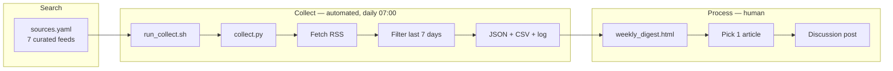

# Final Report — Setup Collect

**Project:** Automated Collect workflow for weekly technology discussion posts  
**Author:** Sanjay Varghese Stephen  
**Date:** 26 October 2026  
**Repository:** https://github.com/sstephen-2102/setup-collect  
**Local path:** `Cursor Projects/Setup Collect`

---

## 1. What this project is

Each week the course requires a review of **one technology article published in the last 7 days**. That only works if a Collect layer already exists: a short list of trusted sources, and a repeatable way to pull new items from them instead of starting from a blank search every Sunday.

This project is that Collect layer. It is the **Collect** stage of the class *Search, Collect, Process* loop:

| Stage | Who | What |
|---|---|---|
| **Search** | Human | Curate which sources to watch, and why |
| **Collect** | Automated, daily | Fetch RSS/Atom feeds, keep the last 7 days, write a ranked digest |
| **Process** | Human, weekly | Read the digest, pick one in-window article, write the discussion post |

The pipeline does **not** write the discussion post. It guarantees a fresh, dated pool of candidates. Article selection and writing stay editorial.

---

## 2. Repository

The project is a public GitHub repository on the course account:

**https://github.com/sstephen-2102/setup-collect**

- Default branch: `main`
- First commit: automated RSS Collect workflow, architecture docs, first-run digest, and screenshots
- Clone:

```bash
git clone https://github.com/sstephen-2102/setup-collect.git
cd setup-collect
./run_collect.sh
open data/weekly_digest.html
```

### Layout

```text
setup-collect/
├── sources.yaml              Search catalog (7 feeds + why each is included)
├── collect.py                Collect engine
├── run_collect.sh            venv bootstrap + runner
├── requirements.txt          feedparser, PyYAML, requests, python-dateutil
├── FINAL_REPORT.md           this document
├── ARCHITECTURE.md           technical architecture
├── DISCUSSION_POST.md        course discussion text
├── README.md
├── schedule/
│   ├── com.sanjay.techcollect.plist   macOS launchd job, daily 07:00
│   └── README.md
├── data/                     JSON, CSV, HTML/Markdown digest, collect.log
└── docs/                     architecture page, first-run page, screenshots
```

The virtual environment (`.venv`) is not in git. `run_collect.sh` creates it on first run.

---

## 3. Design

### 3.1 Why this design

A ChatGPT subscription plus manual browsing would satisfy the assignment in principle, and it would fail the “last 7 days” rule whenever a Sunday is busy. An RSS collector is a better Collect layer because:

- Every chosen source publishes a public feed, so collection does not depend on scraping.
- Dates come from the feed, so the 7-day window is mechanical rather than remembered.
- Failures are visible. If IEEE Spectrum or a company blog goes down, the source-health table says so.
- The same run produces JSON, CSV, Markdown, and HTML, so review can happen in a browser or a spreadsheet.

Search stays human (`sources.yaml`). Collect is automated (`collect.py` + launchd). Process stays human.

### 3.2 Data flow

```text
sources.yaml
     │
     ▼
collect.py  ──HTTP GET + custom User-Agent──►  RSS/Atom feeds (7 sources)
     │
     ├─ parse title, URL, published date, summary
     ├─ drop items older than 7 days
     ├─ score titles/summaries against AI/tech keywords
     ├─ dedupe by SHA-256 of the article URL
     │
     ├─► data/articles.json
     ├─► data/articles.csv
     ├─► data/weekly_digest.md
     ├─► data/weekly_digest.html   ──► Sunday article pick ──► discussion post
     └─► data/collect.log
```



A browser diagram of the same split is in [`docs/architecture.html`](docs/architecture.html). Screenshots are in [`docs/screenshots/`](docs/screenshots/).

### 3.3 Source catalog

Seven sources, not twenty, so the digest stays readable. The mix is the design: independent journalism, engineering depth, industry news, a professional society, an aggregator, a vendor blog, and consumer/policy coverage.

| Source | Role | Why it is in the set |
|---|---|---|
| MIT Technology Review | Independent journalism | Implication-first coverage; a better discussion-post seed than a launch recap |
| Ars Technica | Technical journalism | Engineering detail to test claims on models, chips, and security |
| TechCrunch | Industry / startup | Funding, launches, and platform strategy that slower magazines miss |
| IEEE Spectrum | Professional society | Hardware, energy, and robotics from an engineering magazine |
| Hacker News | Aggregator | Papers and independent blogs; comments are not treated as a source of record |
| Google AI Blog | Company research blog | Primary-source vendor write-up to compare against independent coverage |
| The Verge | Consumer tech / policy | Regulation and how a technology actually reaches users |

Each entry in `sources.yaml` stores `name`, `category`, `homepage`, `rss`, and a `why` paragraph. The collector refuses to run if fewer than five sources are configured.

---

## 4. Frequency

Collection is **daily**. Editorial work is **weekly**. That split is the cadence, not an afterthought: daily ingest exists so a skipped Saturday does not empty the Sunday 7-day window.

| When | What | Owner | Time |
|---|---|---|---|
| Daily, 7:00 AM (local) | Fetch feeds, trim to last 7 days, refresh the digest | Automated (`launchd` job `com.sanjay.techcollect`) | unattended |
| Wednesday evening | Skim `data/weekly_digest.html`, star 2–3 candidates | Human | ~15 minutes |
| Sunday morning | Confirm the article is ≤7 days old, read it, write the discussion post | Human | ~45–60 minutes |
| First Sunday of each month | Source-list maintenance: drop dead feeds, add a replacement if the mix is stale | Human | ~20 minutes |
| After every run | Append source health to `data/collect.log` | Automated | — |

Starring candidates is a human Process step (notes / CSV), not a digest UI feature. The monthly review keeps the list at seven instead of letting unread sources accumulate.

To enable the daily job on this Mac:

```bash
cp "/Users/sanjayvarghese/Cursor Projects/Setup Collect/schedule/com.sanjay.techcollect.plist" \
   "$HOME/Library/LaunchAgents/com.sanjay.techcollect.plist"
launchctl load "$HOME/Library/LaunchAgents/com.sanjay.techcollect.plist"
launchctl start com.sanjay.techcollect
```

Cron equivalent: `0 7 * * *` calling `run_collect.sh`.

---

## 5. Implementation

### 5.1 Stack

| Piece | Choice |
|---|---|
| Language | Python 3.14 |
| Isolation | project `.venv`, created by `run_collect.sh` |
| Feed parsing | `feedparser` |
| HTTP | `requests`, 25s timeout, custom User-Agent `TechCollect/1.0` |
| Config | `sources.yaml` via `PyYAML` |
| Dates | feed `published_parsed` / `updated_parsed`, then `python-dateutil` |
| Scheduler | macOS `launchd` (cron documented as fallback) |
| Outputs | JSON (canonical store), CSV (spreadsheet), Markdown, HTML digest |

No scraping. No LLM in the Collect path. Keyword scoring is a simple title/summary boost so the digest is not only reverse-chronological.

### 5.2 Collect pipeline (`collect.py`)

Each daily run does the following:

1. **Load config** from `sources.yaml` (`window_days: 7`, `max_articles_per_source: 20`, keyword list).
2. **Fetch independently.** One broken feed does not stop the others.
3. **Parse** title, URL, published/updated date, and summary. HTML is stripped from summaries.
4. **Filter** to the last 7 days. Items with no usable date are kept only while they remain in the live feed, then dropped on the next window trim.
5. **Score** against keywords such as AI, LLM, GPU, semiconductor, cybersecurity, privacy, regulation, robotics, and named vendors.
6. **Cap** at 20 kept items per source, newest/highest-score first.
7. **Dedupe** by SHA-256 of the article URL so overlapping aggregator and journalism coverage collapses to one record.
8. **Merge** with the previous `data/articles.json`, then trim again to the current window.
9. **Write** `articles.json`, `articles.csv`, `weekly_digest.md`, `weekly_digest.html`, and append `collect.log`.

Optional flags:

```bash
./run_collect.sh --days 7
./run_collect.sh --collect-only
./run_collect.sh --digest-only
```

### 5.3 Failure handling

- HTTP errors, empty feeds, and parse errors are recorded in the digest’s **source-health** table (`OK` / `FAILED`, fetched, kept, notes).
- The HTML digest shows `Sources healthy N/7` so a dead feed is obvious on Wednesday, not discovered on Sunday.
- Duplicate URLs from overlapping coverage become a single record.

### 5.4 First live run (25 October 2026)

All seven sources responded. **89 articles** were kept in the 7-day window.

| Source | Fetched | Kept |
|---|---:|---:|
| MIT Technology Review | 10 | 10 |
| Ars Technica | 20 | 20 |
| TechCrunch | 20 | 20 |
| IEEE Spectrum | 30 | 8 |
| Hacker News | 20 | 20 |
| Google AI Blog | 20 | 1 |
| The Verge | 10 | 10 |

Google AI Blog keeping 1 of 20 is the 7-day filter working: most posts in that feed were older than the window. Evidence pages: [`docs/first_run.html`](docs/first_run.html), [`data/weekly_digest.html`](data/weekly_digest.html), [`docs/screenshots/`](docs/screenshots/).

---

## 6. How to run it

```bash
git clone https://github.com/sstephen-2102/setup-collect.git
cd setup-collect
chmod +x run_collect.sh
./run_collect.sh
open data/weekly_digest.html
```

On review days, open the HTML digest, confirm the candidate’s date is inside 7 days, read the article, and write the discussion post by hand.

---

## 7. What success looks like for this assignment

The course asked for at least five monitored sources with justification, a documented Collect architecture (description, diagram, screenshots), and the frequency of review. This project delivers:

- **Seven** justified sources in both `sources.yaml` and the discussion post
- A technically sound RSS collector with a 7-day window, ranking, dedupe, and source health
- Diagrams (`ARCHITECTURE.md`, `docs/architecture.html`, screenshots), named tools, and a daily schedule
- A weekly editorial cadence that is separate from daily collection, with an explicit reason for that split

The public repo is the packaged form of that workflow: code, config, schedule, first-run evidence, and this report.
